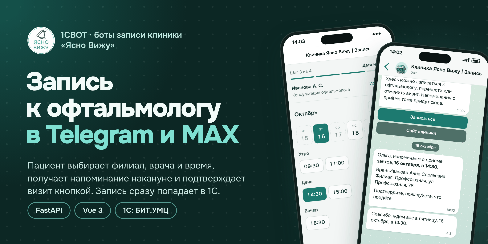
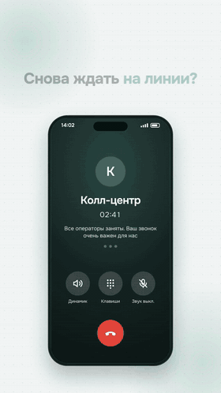
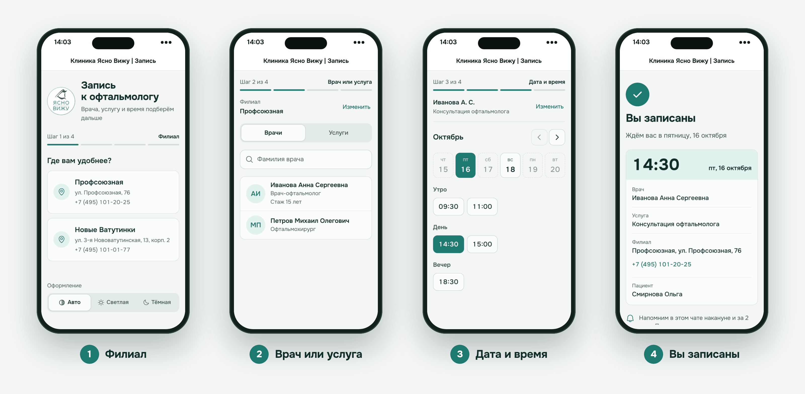
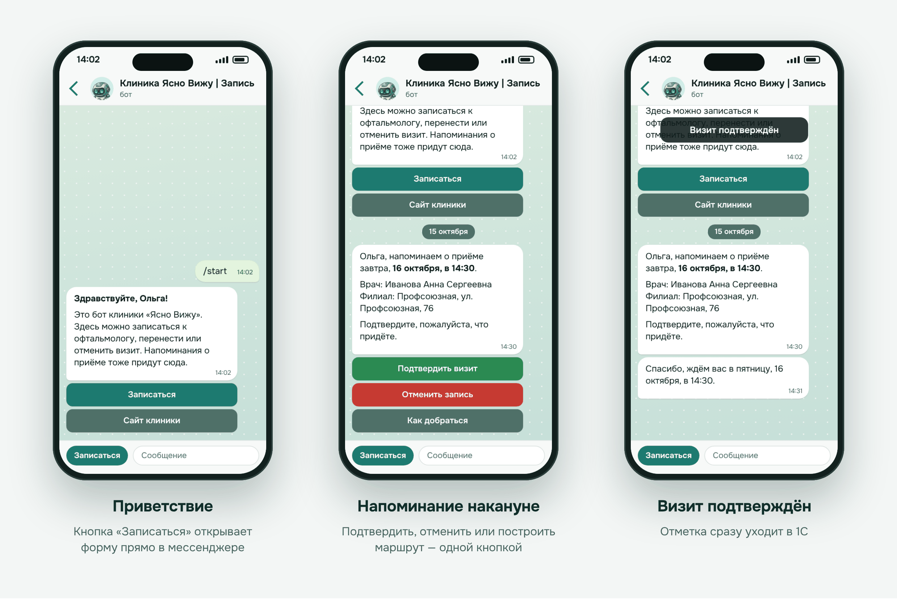
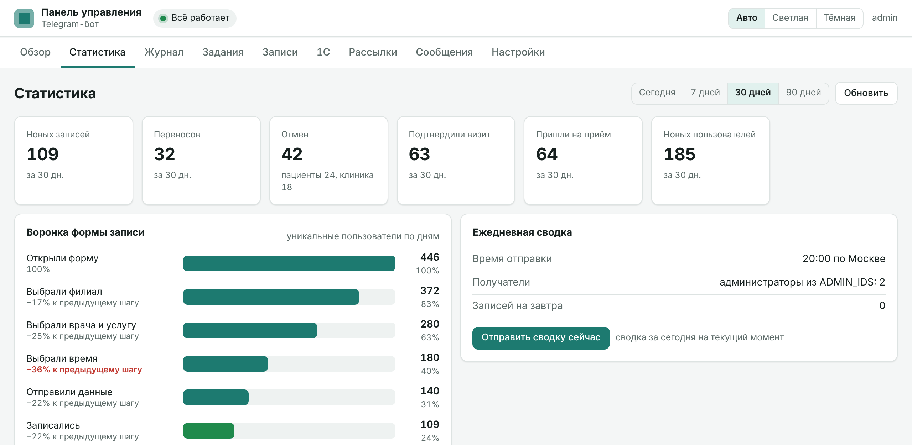
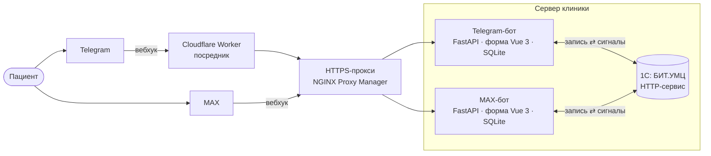

<p align="center">
  
</p>

<p align="center">
  <a href="https://github.com/RAZORG777/1cbotrework/actions/workflows/ci.yml"></a>
  
  
  
  
  
</p>

# 1CBOT — запись к офтальмологу в Telegram и MAX

Боты офтальмологической клиники «Ясно Вижу». Пациент открывает форму прямо в мессенджере,
выбирает филиал, врача, услугу и время, а запись сразу появляется в 1С: БИТ.Управление
медицинским центром. Накануне бот напоминает о приёме, визит подтверждается одной кнопкой.

Колл-центр клиники остаётся основным способом записи, бот — для тех, кому неудобно звонить.

<p align="center">
  
  <br><sub>Промо-ролик для Reels: занятая линия → запись в боте → напоминание накануне</sub>
</p>

## Как это выглядит

### Запись за четыре шага



Форма — мини-приложение Telegram и MAX: светлая и тёмная тема, запись по врачу или по услуге,
запись за другого человека, данные пациента запоминаются для следующих записей.

### Бот в чате



### Админка



Подробнее — в [docs/admin.md](docs/admin.md).

## Что умеет

**Пациенту**
- запись к врачу в двух филиалах, перенос и отмена — в форме или кнопкой в чате;
- напоминания за сутки и за два часа с кнопками «Подтвердить визит», «Отменить запись»,
  «Как добраться»;
- просьба оставить отзыв после визита;
- новости и акции клиники — только с согласия, отписка одной кнопкой или командой `/news`.

**Клинике**
- запись сразу в 1С: поиск пациента и медкарты, свободные окна из расписания врача;
- 1С сама сообщает ботам об отмене записи администратором и о состоявшемся визите;
- админка: здоровье сервисов, журнал, задания, записи, консоль 1С, шаблоны сообщений;
- рассылки пользователям бота: текст, картинка, кнопка, пробная отправка себе;
- ежедневная сводка администраторам и воронка формы записи — видно, на каком шаге уходят пациенты.

**Данные и надёжность**
- персональные данные удаляются через 30 дней после визита или отмены, в журналы не пишутся;
- пользователь мессенджера подтверждается подписью `initData`, вебхуки — секретами;
- админка блокирует подбор пароля, порты ботов закрыты от сети;
- Telegram- и MAX-бот независимы: сбой одного не затрагивает другой.

## Как это устроено



| Слой | Технологии |
|------|------------|
| Боты | Python 3.13, FastAPI, SQLAlchemy 2 + SQLite, APScheduler, httpx, loguru |
| Форма записи | Vue 3, TypeScript, Vite, Tailwind CSS |
| 1С | HTTP-сервис и расширение `Бот_Интеграция` для БИТ.УМЦ ([код](onec/)) |
| Тесты | pytest + respx, Vitest, Playwright — без обращения к настоящей 1С и мессенджерам |
| Инфраструктура | Windows Server, планировщик заданий, NGINX Proxy Manager, Cloudflare Workers, GitHub Actions |
| Процесс | Spec Kit: каждая функция — спецификация, план и задачи в [specs/](specs/) |

## Структура

```text
telegram_bot/        Telegram-бот (порт 8001)
  app/               FastAPI: config, auth, db, models, onec_client, messenger, reminders, stats, routes/
  static/app/        сборка формы записи (из webapp/, в git не хранится)
  scripts/           register_webhook.py, send_onec_signal.py
  tests/             unit / contract / integration (pytest, заглушки 1С и Telegram)
max_bot/             MAX-бот (порт 8002, все пути под /max) — та же раскладка, свой код
webapp/              форма записи: Vite + Vue 3 + TypeScript + Tailwind, сборка на каждый бот
onec/                код 1С: HTTP-сервис, модуль «Заявки», расширение Бот_Интеграция
deploy/              выкладка, автозапуск и брандмауэр (Windows), воркеры Cloudflare
docs/, specs/        документация, контракт с 1С, спецификации Spec Kit
```

Боты не импортируют код друг друга (принцип III [конституции](.specify/memory/constitution.md)).

## Быстрый старт

```bash
cd telegram_bot                    # или max_bot
python -m venv .venv
.venv\Scripts\activate             # Linux/macOS: source .venv/bin/activate
pip install -r requirements-dev.txt
copy .env.example .env             # заполнить значения
python -m app.main
```

Без обязательных переменных бот не запустится и сообщит, каких не хватает.

Форма записи собирается отдельно (нужен Node.js 22 LTS):

```bash
cd webapp
npm ci
npm run build        # → telegram_bot/static/app и max_bot/static/app
npm run dev          # разработка; вне мессенджера форма покажет «Откройте запись через бота»
```

### Тесты

```bash
ruff check . && ruff format --check .
pytest -q
cd webapp && npm run typecheck && npm test && npm run build && npm run e2e
```

Playwright проходит обе сборки формы с заглушками SDK и API, снимки экранов 320/390/430 px в
светлой и тёмной теме — в `webapp/e2e/screenshots/`. На каждый PR тесты запускает GitHub Actions.

## Документация

| Документ | О чём |
|----------|-------|
| [docs/deploy.md](docs/deploy.md) | выкладка на сервер и переход со старой версии |
| [docs/security.md](docs/security.md) | автозапуск, брандмауэр, Cloudflare, меры по аудиту |
| [docs/admin.md](docs/admin.md) | админка, рассылки, ежедневная сводка |
| [docs/onec-contract.md](docs/onec-contract.md) | контракт обмена с 1С |
| [docs/rework-plan.md](docs/rework-plan.md) | план реворка по этапам |
| [.specify/memory/constitution.md](.specify/memory/constitution.md) | правила проекта |
| [specs/](specs/) | спецификации: безопасность, медкарта, подтверждение визита, новая форма, тексты бота, админка, рассылки, сводка и воронка |
